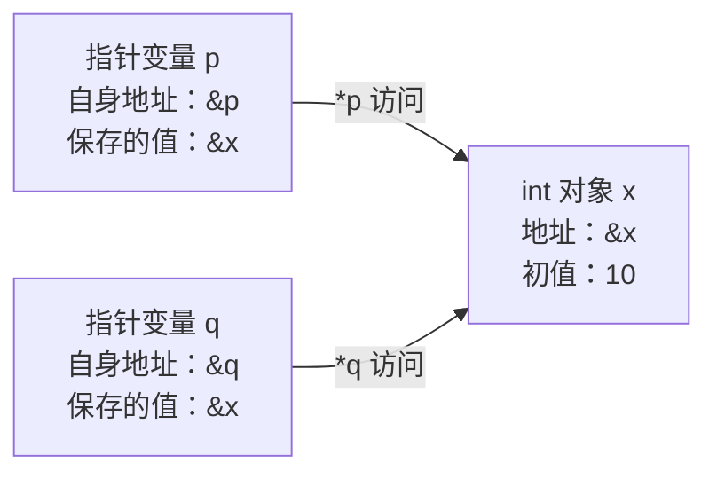

# 10_要点

### 1. 从字节到对象

C 程序中的对象是一块用来保存值的存储区域，普通对象的表示占用若干连续字节；对象的类型决定如何解释这些存储。C 保证 `sizeof(char) == 1`，但一个 C 字节有多少位由 `CHAR_BIT` 给出，不能把“一个字节恒等于 8 位”当成所有 C 实现的规则。`int` 和指针的大小要在目标实现上测量，不能把常见的 4 字节和 8 字节写成语言保证。（C11 §3.6、§6.2.5、§6.2.6.1、§6.5.3.4；来源 S1、S3）

### 2. `&` 取地址，`*` 经指针访问对象

对本课中的普通变量 `x`，表达式 `&x` 得到指向它的指针；若 `p` 有效地指向 `x`，读取 `*p` 就读取 `x`，对 `*p` 赋值就修改 `x`。声明中的 `int *p` 表示“`p` 是指向 `int` 的指针”，这里的 `*` 是声明符的一部分，和表达式中的解引用用途不同。指针转换或强制类型转换本身不会创造一个可合法访问的对象；实际访问仍须满足生存期、边界、对齐和类型规则。（C11 §6.5.3.2、§6.5 p7、§6.2.8；来源 S1）

### 3. 指针变量也有自己的存储

`p` 是指针变量中保存的值，`&p` 是这一个指针变量的地址；它们回答的是两个问题。若 `p` 和 `q` 都保存 `&x`，它们是两个独立的指针对象，却能访问同一个 `x`，因此通过一个指针修改 `x` 后，另一个也能读到新值。地址可用来建立对象关系，但 C 不保证所有对象组成可任意遍历的平坦地址空间，也不保证局部变量相邻或按声明顺序排列。（C11 §6.2.5、§6.5.3.2、§6.5.6；来源 S1）

图中的箭头表示指向关系，不表示物理距离。执行 `*p = 20` 后，`x` 变成 20，`p` 和 `q` 保存的指针值都不变。

### 4. 数组是数组；数组表达式在多数场合转换为指针

对 `int a[4]`，数组对象包含 4 个连续的 `int` 元素；在初始化指针或传递实参等多数表达式场合，`a` 转换为指向首元素的 `int *`。典型不发生这一转换的场合是 `sizeof a`、一元 `&a`，以及用字符串字面量初始化字符数组；因此 `sizeof a` 仍得到整个数组的字节数。`&a` 的类型是 `int (*)[4]`，它指向整个数组，所以 `a + 1` 跨过一个元素，`&a + 1` 跨过整个数组；后一个指针已位于这个数组对象之后，不能解引用。（C11 §6.2.5 p20、§6.3.2.1 p3、§6.5.6；来源 S1、S4）

### 5. “数组传入函数”包含两条规则

调用函数时，数组实参通常先转换成首元素指针；另一方面，函数声明中的数组形参，例如 `void f(int a[4])`，会被调整为指针形参，效果相当于 `void f(int *a)`。所以这里的 `[4]` 不会把整个数组按值传入，也不会在运行时自动检查实参数组的长度；函数中的 `sizeof a` 得到的是指针大小。C 的实参按值传递：函数可以通过这个指针副本修改调用者的元素，但给形参本身重新赋指针值，不会改掉调用者的指针变量。（C11 §6.3.2.1 p3、§6.7.6.3 p7、§6.5.2.2 p4；来源 S1、S4、S5）

### 6. 指针算术按元素移动，并有合法范围

对指向数组元素的 `int *p`，`p + 1` 移动到下一个 `int` 元素，而不是下一个字节；`a[i]` 等价于 `*(a + i)`。相关算术的结果必须仍在同一个数组内，或恰好位于末元素之后的位置；可以形成并比较这个尾后指针，但不能通过它读写元素。不能因为两个数组在本机恰好挨着，就跨数组做减法或把它们当一个大数组访问。（C11 §6.5.2.1 p2、§6.5.6 p7–p9；来源 S1）

### 7. 地址存在过，不代表对象现在还活着

普通块作用域局部变量具有自动存储期，离开其生存期后不能再通过原指针访问；返回它的地址不能延长其生存期。`NULL` 表示空指针，解引用空指针不合法，但“不是 `NULL`”也不能证明指针有效：悬空、越界和错误类型的指针都可能非空。未定义行为表示标准不再约束程序的行为，不能承诺“一定崩溃”或“总会打印垃圾值”。（C11 §6.2.4、§6.3.2.3、§6.5.3.2；来源 S1）

### 8. `const` 限制哪一层修改

`const int *p` 允许改变 `p` 的指向，但不允许经 `*p` 修改所指的 `int`；`int *const p` 固定 `p` 的指向，但允许修改它指向的可写 `int`。`const int *const p` 同时限制这两种修改，因此读声明时要分别问“指针能否改”和“经它能否改对象”。若原对象 `x` 并非 `const`，它仍可经其他合法途径改变，`const int *p = &x` 不会冻结 `x`；若原对象本来定义为 `const`，强行去掉限定后修改它则是未定义行为。（C11 §6.7.3、§6.5.16；来源 S1）

### 9. `volatile` 要求保留相应访问的可观察语义

`volatile` 用来表达对象可能受到实现未知因素的影响，相关访问要遵守实现对易变对象的规则；它不等于“关闭整个程序的优化”。在 GCC 下，把一个易变标量的两次读取写在两个完整表达式中，编译器不能把它们当成一次普通读取来消除其中一次。它不保证原子读改写、不提供线程间同步，也不能充当普通内存访问的通用屏障。（C11 §5.1.2.3、§6.7.3；来源 S1、S2）

**为什么嵌入式寄存器访问通常不能省：** 在 Cortex-M 的典型内存映射外设中，硬件可以更新状态位，读取或写入某个寄存器也可能有硬件副作用。如果用普通指针访问，编译器可能复用读值或消除它认为多余的访问，使程序不能按外设要求工作；通常应采用芯片厂家提供的、带正确 `volatile` 限定的寄存器声明或访问接口。

这里需要限定的是**所指的寄存器对象**，典型类型是 `volatile unsigned int *`，不是只让指针变量自身易变的 `unsigned int *volatile`。只读状态寄存器常通过指向 `const volatile` 对象的指针暴露：软件经该接口只读，硬件仍可改变状态。真实芯片的地址、访问宽度、对齐、读清零/写一清零语义以及屏障要求都**需查目标芯片与工具链手册确认**；本课不假设 `unsigned int` 恰好匹配任何寄存器，也不在 PC 上解引用示例硬件地址。

### 10. 正确打印大小和地址

`sizeof` 的结果类型是 `size_t`，用 `%zu` 打印；对象指针用 `%p` 打印，并显式转换成 `void *`。对本课非变长数组的对象，`sizeof *p` 查询的是所指类型的大小，不执行一次实际解引用，和运行时求值 `*p` 不同。`%p` 的文字格式和具体地址取决于实现与本次运行，比较实验时应检查关系而不是照抄地址。（C11 §6.5.3.4、§7.21.6.1、§7.21.6.3；来源 S1、S3）

### 常见坑：错误、后果和修正

1. **未初始化就解引用。** 错误写法：先声明 `int *p;`，随后执行 `*p = 10;`。后果：局部指针没有取得有效目标，程序有未定义行为。正确做法：先让它指向生存期内的可写对象，例如实验 1 的 `int *p = &x;`，再访问。
2. **在指针形参里猜长度。** 错误写法：用 `sizeof a / sizeof a[0]` 计算数组形参的长度。后果：除出来的是指针字节数与元素字节数之比，可能少处理、越界或偶然碰巧正确。正确做法：在调用者仍持有数组对象时求长度，并作为 `size_t count` 传入；实验 2 给出完整程序。
3. **返回普通局部变量的地址。** 错误写法：局部 `int x` 定义后执行 `return &x;`。后果：返回后对象已结束生存期。正确做法：只需要结果就直接返回 `int` 值；需要写入调用者对象，就接收调用者提供的有效指针。自测 8 专门检查这件事。
4. **把尾后指针当成元素。** 错误写法：遍历时用 `i <= count`，再访问 `a[i]`。后果：最后一次访问超出合法元素范围。正确做法：使用 `i < count`；允许计算 `a + count`，但不通过它读写。
5. **把 `const` 指针误认为快照。** 错误认识：`const int *p = &x` 后，`*p` 永远不会变化。后果：忽略其他合法别名对非 `const` 对象的修改。正确做法：理解它限制经 `p` 写入；若要快照，应复制当前值，例如 `int snapshot = *p;`。
6. **把 `volatile` 当锁或原子操作。** 错误做法：给共享计数器加 `volatile`，就让多个执行主体同时执行 `counter++`。后果：读、加、写仍可能被交错打断，在 C 线程中还可能形成数据竞争。正确做法：根据场景使用同步机制、原子操作或平台临界区，并核对平台要求；本课不展开实现。

### 来源与条款定位

- **S1，标准定位入口：** [WG14 N1570，C11 公开委员会草案](https://www.open-std.org/jtc1/sc22/wg14/www/docs/n1570.pdf)。重点是 §6.3.2.1（数组表达式转换）、§6.5.3.2（取地址与解引用）、§6.5.3.4（`sizeof`）、§6.7.6.3 p7（数组形参调整）和 §6.7.3（类型限定符）。这里使用公开草案编号，不冒称已经取得正式付费 ISO 文本；原任务把 §6.3.2.1 简称为“地址与指针”，本课已拆开对应的真正条款。
- **S2，编译器官方说明：** [GCC：When is a Volatile Object Accessed?](https://gcc.gnu.org/onlinedocs/gcc/Volatiles.html)；[GCC：Qualifiers](https://gcc.gnu.org/onlinedocs/gcc/Qualifiers-implementation.html)。这是 GCC 的实现说明，不能直接推广为所有编译器的汇编行为。
- **S3，辅助参考：** [cppreference：C `sizeof`](https://www.cppreference.com/c/language/sizeof)。用于交叉核对大小、字节与数组计数。
- **S4，辅助参考：** [cppreference：C 数组](https://www.cppreference.com/c/language/array)。用于交叉核对数组转换及例外；阅读时注意页面还包含 C23 内容，本课仅采用 C11 范围。
- **S5，辅助参考：** [cppreference：C 函数声明](https://www.cppreference.com/c/language/function_declaration)。用于交叉核对数组形参的类型调整。

本次通过文档连接器读取了 S2～S5 的相关段落；S1 的直接下载受本机会话网络权限限制，未声称完成原 PDF 逐条复核。书名可作为延伸阅读，本课未取得《C 和指针》《C 专家编程》的原文，因此不伪造页码或引用。
