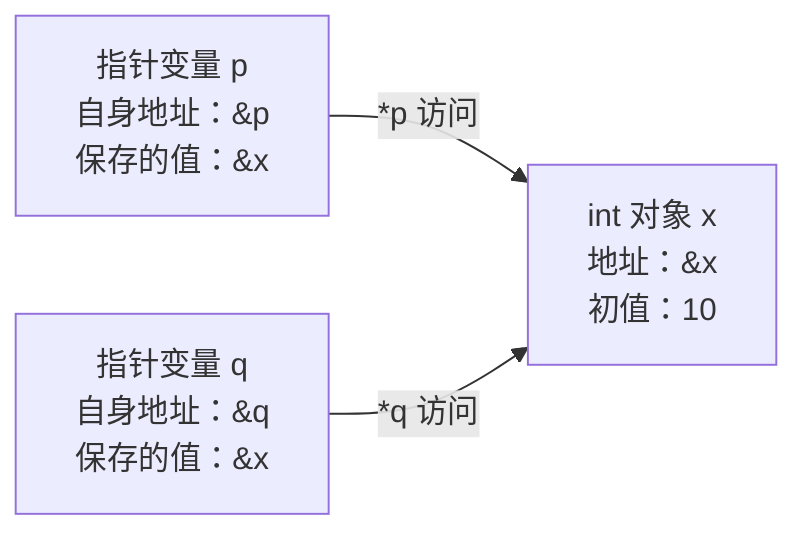

# 指针与内存模型 · C 语言核心第 1 课

## 00_导读

**先记住一句话：变量是对象，指针值用来指向对象；`p` 表示指向哪里，`*p` 表示经这个指针访问所指对象，`&p` 则是指针变量自身的地址。** 判断一次访问是否合法，还要检查对象的类型、边界和生存期。

### 阅读入口

- [导读](01_指针与内存模型/00_导读.md)：学习目标与顺序。
- [要点](01_指针与内存模型/10_要点.md)：概念、易错点与出处。
- [动手](01_指针与内存模型/20_动手.md)：4 个完整实验。
- [自测](01_指针与内存模型/30_自测.md)：10 题，答案默认折叠。
- [复盘](01_指针与内存模型/99_复盘.md)：记录错误、安排重做。
- [生成与验证记录](01_指针与内存模型/90_验证记录.md)：本机验证结果与来源核对边界。

### 要解决的具体问题

1. 为什么修改 `*p` 会改变另一个变量，而修改 `p` 只是让指针改指别处？
2. 为什么调用者可以用 `sizeof a / sizeof a[0]` 得到数组长度，函数里的同名形参却通常不行？
3. 为什么代码能编译，访问它仍可能越界、悬空或触发未定义行为？
4. 为什么硬件寄存器访问通常需要 `volatile`，而给普通共享变量加它仍不能解决并发问题？

### 学完后的可验证动作

- 给出 `int x = 10; int *p = &x;`，能在图上标出 `x`、`p`、`&x`、`&p`、`*p`，并预测一次赋值改变哪个对象。
- 写出接收“首元素指针 + 元素数量”的函数，能正确处理约定允许的空输入。
- 正确区分 `const int *`、`int *const`、`const int *const`，解释各自限制哪一种修改。
- 用 GCC 编译运行本课实验；能指出反例中哪些有确定输出，哪些不能预测输出。
- 能解释实验 4 中两次 `volatile` 读取的意义，同时说清它没有提供什么保证。

### 前置知识、时间与环境

需要会使用变量、赋值、`if`、`for`、函数调用和一维数组的基本语法；不要求接触开发板。建议用 **90～120 分钟**：要点 20 分钟，实验 40～50 分钟，自测 20～30 分钟，复盘 10～20 分钟。

主线使用 **C11、GCC、普通用户态程序**。命令按 Windows PowerShell + MinGW/MSYS2 写；本课的“内存模型”讨论对象、地址、类型、边界和生存期，不展开 C11 线程内存模型。Cortex-M 只用于解释寄存器访问的背景，所有可运行实验都不访问真实硬件地址。

先预测再运行；答错时回到对应实验，只重做暴露问题的部分。完成标准是“能解释并修改程序”，不是记住本机某次打印的地址。

## 10_要点

### 1. 从字节到对象

C 程序中的对象是一块用来保存值的存储区域，普通对象的表示占用若干连续字节；对象的类型决定如何解释这些存储。C 保证 `sizeof(char) == 1`，但一个 C 字节有多少位由 `CHAR_BIT` 给出，不能把“一个字节恒等于 8 位”当成所有 C 实现的规则。`int` 和指针的大小要在目标实现上测量，不能把常见的 4 字节和 8 字节写成语言保证。（C11 §3.6、§6.2.5、§6.2.6.1、§6.5.3.4；来源 S1、S3）

### 2. `&` 取地址，`*` 经指针访问对象

对本课中的普通变量 `x`，表达式 `&x` 得到指向它的指针；若 `p` 有效地指向 `x`，读取 `*p` 就读取 `x`，对 `*p` 赋值就修改 `x`。声明中的 `int *p` 表示“`p` 是指向 `int` 的指针”，这里的 `*` 是声明符的一部分，和表达式中的解引用用途不同。指针转换或强制类型转换本身不会创造一个可合法访问的对象；实际访问仍须满足生存期、边界、对齐和类型规则。（C11 §6.5.3.2、§6.5 p7、§6.2.8；来源 S1）

### 3. 指针变量也有自己的存储

`p` 是指针变量中保存的值，`&p` 是这一个指针变量的地址；它们回答的是两个问题。若 `p` 和 `q` 都保存 `&x`，它们是两个独立的指针对象，却能访问同一个 `x`，因此通过一个指针修改 `x` 后，另一个也能读到新值。地址可用来建立对象关系，但 C 不保证所有对象组成可任意遍历的平坦地址空间，也不保证局部变量相邻或按声明顺序排列。（C11 §6.2.5、§6.5.3.2、§6.5.6；来源 S1）



图中的箭头表示指向关系，不表示物理距离。执行 `*p = 20` 后，`x` 变成 20，`p` 和 `q` 保存的指针值都不变。

### 4. 数组是数组；数组表达式在多数场合转换为指针

对 `int a[4]`，数组对象包含 4 个连续的 `int` 元素；在初始化指针或传递实参等多数表达式场合，`a` 转换为指向首元素的 `int *`。典型不发生这一转换的场合是 `sizeof a`、一元 `&a`，以及用字符串字面量初始化字符数组；因此 `sizeof a` 仍得到整个数组的字节数。`&a` 的类型是 `int (*)[4]`，它指向整个数组，所以 `a + 1` 跨过一个元素，`&a + 1` 跨过整个数组；后一个指针已位于这个数组对象之后，不能解引用。（C11 §6.2.5 p20、§6.3.2.1 p3、§6.5.6；来源 S1、S4）

### 5. “数组传入函数”包含两条规则

调用函数时，数组实参通常先转换成首元素指针；另一方面，函数声明中的数组形参，例如 `void f(int a[4])`，会被调整为指针形参，效果相当于 `void f(int *a)`。所以这里的 `[4]` 不会把整个数组按值传入，也不会在运行时自动检查实参数组的长度；函数中的 `sizeof a` 得到的是指针大小。C 的实参按值传递：函数可以通过这个指针副本修改调用者的元素，但给形参本身重新赋指针值，不会改掉调用者的指针变量。（C11 §6.3.2.1 p3、§6.7.6.3 p7、§6.5.2.2 p4；来源 S1、S4、S5）

### 6. 指针算术按元素移动，并有合法范围

对指向数组元素的 `int *p`，`p + 1` 移动到下一个 `int` 元素，而不是下一个字节；`a[i]` 等价于 `*(a + i)`。相关算术的结果必须仍在同一个数组内，或恰好位于末元素之后的位置；可以形成并比较这个尾后指针，但不能通过它读写元素。不能因为两个数组在本机恰好挨着，就跨数组做减法或把它们当一个大数组访问。（C11 §6.5.2.1 p2、§6.5.6 p7–p9；来源 S1）

### 7. 地址存在过，不代表对象现在还活着

普通块作用域局部变量具有自动存储期，离开其生存期后不能再通过原指针访问；返回它的地址不能延长其生存期。`NULL` 表示空指针，解引用空指针不合法，但“不是 `NULL`”也不能证明指针有效：悬空、越界和错误类型的指针都可能非空。未定义行为表示标准不再约束程序的行为，不能承诺“一定崩溃”或“总会打印垃圾值”。（C11 §6.2.4、§6.3.2.3、§6.5.3.2；来源 S1）

### 8. `const` 限制哪一层修改

`const int *p` 允许改变 `p` 的指向，但不允许经 `*p` 修改所指的 `int`；`int *const p` 固定 `p` 的指向，但允许修改它指向的可写 `int`。`const int *const p` 同时限制这两种修改，因此读声明时要分别问“指针能否改”和“经它能否改对象”。若原对象 `x` 并非 `const`，它仍可经其他合法途径改变，`const int *p = &x` 不会冻结 `x`；若原对象本来定义为 `const`，强行去掉限定后修改它则是未定义行为。（C11 §6.7.3、§6.5.16；来源 S1）

### 9. `volatile` 要求保留相应访问的可观察语义

`volatile` 用来表达对象可能受到实现未知因素的影响，相关访问要遵守实现对易变对象的规则；它不等于“关闭整个程序的优化”。在 GCC 下，把一个易变标量的两次读取写在两个完整表达式中，编译器不能把它们当成一次普通读取来消除其中一次。它不保证原子读改写、不提供线程间同步，也不能充当普通内存访问的通用屏障。（C11 §5.1.2.3、§6.7.3；来源 S1、S2）

**为什么嵌入式寄存器访问通常不能省：** 在 Cortex-M 的典型内存映射外设中，硬件可以更新状态位，读取或写入某个寄存器也可能有硬件副作用。如果用普通指针访问，编译器可能复用读值或消除它认为多余的访问，使程序不能按外设要求工作；通常应采用芯片厂家提供的、带正确 `volatile` 限定的寄存器声明或访问接口。

这里需要限定的是**所指的寄存器对象**，典型类型是 `volatile unsigned int *`，不是只让指针变量自身易变的 `unsigned int *volatile`。只读状态寄存器常通过指向 `const volatile` 对象的指针暴露：软件经该接口只读，硬件仍可改变状态。真实芯片的地址、访问宽度、对齐、读清零/写一清零语义以及屏障要求都**需查目标芯片与工具链手册确认**；本课不假设 `unsigned int` 恰好匹配任何寄存器，也不在 PC 上解引用示例硬件地址。

### 10. 正确打印大小和地址

`sizeof` 的结果类型是 `size_t`，用 `%zu` 打印；对象指针用 `%p` 打印，并显式转换成 `void *`。对本课非变长数组的对象，`sizeof *p` 查询的是所指类型的大小，不执行一次实际解引用，和运行时求值 `*p` 不同。`%p` 的文字格式和具体地址取决于实现与本次运行，比较实验时应检查关系而不是照抄地址。（C11 §6.5.3.4、§7.21.6.1、§7.21.6.3；来源 S1、S3）

### 常见坑：错误、后果和修正

1. **未初始化就解引用。** 错误写法：先声明 `int *p;`，随后执行 `*p = 10;`。后果：局部指针没有取得有效目标，程序有未定义行为。正确做法：先让它指向生存期内的可写对象，例如实验 1 的 `int *p = &x;`，再访问。
2. **在指针形参里猜长度。** 错误写法：用 `sizeof a / sizeof a[0]` 计算数组形参的长度。后果：除出来的是指针字节数与元素字节数之比，可能少处理、越界或偶然碰巧正确。正确做法：在调用者仍持有数组对象时求长度，并作为 `size_t count` 传入；实验 2 给出完整程序。
3. **返回普通局部变量的地址。** 错误写法：局部 `int x` 定义后执行 `return &x;`。后果：返回后对象已结束生存期。正确做法：只需要结果就直接返回 `int` 值；需要写入调用者对象，就接收调用者提供的有效指针。自测 8 专门检查这件事。
4. **把尾后指针当成元素。** 错误写法：遍历时用 `i <= count`，再访问 `a[i]`。后果：最后一次访问超出合法元素范围。正确做法：使用 `i < count`；允许计算 `a + count`，但不通过它读写。
5. **把 `const` 指针误认为快照。** 错误认识：`const int *p = &x` 后，`*p` 永远不会变化。后果：忽略其他合法别名对非 `const` 对象的修改。正确做法：理解它限制经 `p` 写入；若要快照，应复制当前值，例如 `int snapshot = *p;`。
6. **把 `volatile` 当锁或原子操作。** 错误做法：给共享计数器加 `volatile`，就让多个执行主体同时执行 `counter++`。后果：读、加、写仍可能被交错打断，在 C 线程中还可能形成数据竞争。正确做法：根据场景使用同步机制、原子操作或平台临界区，并核对平台要求；本课不展开实现。

### 来源与条款定位

- **S1，标准定位入口：** [WG14 N1570，C11 公开委员会草案](https://www.open-std.org/jtc1/sc22/wg14/www/docs/n1570.pdf)。重点是 §6.3.2.1（数组表达式转换）、§6.5.3.2（取地址与解引用）、§6.5.3.4（`sizeof`）、§6.7.6.3 p7（数组形参调整）和 §6.7.3（类型限定符）。这里使用公开草案编号，不冒称已经取得正式付费 ISO 文本；原任务把 §6.3.2.1 简称为“地址与指针”，本课已拆开对应的真正条款。
- **S2，编译器官方说明：** [GCC：When is a Volatile Object Accessed?](https://gcc.gnu.org/onlinedocs/gcc/Volatiles.html)；[GCC：Qualifiers](https://gcc.gnu.org/onlinedocs/gcc/Qualifiers-implementation.html)。这是 GCC 的实现说明，不能直接推广为所有编译器的汇编行为。
- **S3，辅助参考：** [cppreference：C `sizeof`](https://www.cppreference.com/c/language/sizeof)。用于交叉核对大小、字节与数组计数。
- **S4，辅助参考：** [cppreference：C 数组](https://www.cppreference.com/c/language/array)。用于交叉核对数组转换及例外；阅读时注意页面还包含 C23 内容，本课仅采用 C11 范围。
- **S5，辅助参考：** [cppreference：C 函数声明](https://www.cppreference.com/c/language/function_declaration)。用于交叉核对数组形参的类型调整。

本次通过文档连接器读取了 S2～S5 的相关段落；S1 的直接下载受本机会话网络权限限制，未声称完成原 PDF 逐条复核。书名可作为延伸阅读，本课未取得《C 和指针》《C 专家编程》的原文，因此不伪造页码或引用。

## 20_动手

四个实验都在普通用户态运行，代码源文件已放在本课的 `examples` 目录。以下 PowerShell 命令从本课目录执行：

```powershell
Set-Location 'C:\Users\18798\Documents\技术蒸馏课程\01_C语言核心\01_指针与内存模型'
```

一键复核所有实验和自测程序：

```powershell
python .\verify.py
```

验证脚本会记录编译命令、编译器版本、源码 SHA-256、输出和退出码。以下所有 `assert` 检查都要求不定义 `NDEBUG`；给出的编译命令已满足这一点。

### 实验 1：修改目标对象与改变指向

**目标：** 区分 `x`、`p`、`&p` 和 `*p`，观察两个指针指向同一个对象时的行为，并测量本机基本大小。

文件：[examples/01_addresses.c](01_指针与内存模型/examples/01_addresses.c)

<!-- lesson-code: examples/01_addresses.c | run -->
```c
#include <assert.h>
#include <limits.h>
#include <stdio.h>

int main(void)
{
    int x = 10;
    int y = 99;
    int *p = &x;
    int *q = p;

    printf("CHAR_BIT=%d\n", CHAR_BIT);
    printf("sizeof_int=%zu\n", sizeof x);
    printf("sizeof_pointer=%zu\n", sizeof p);
    printf("x_addr=%p p_value=%p p_addr=%p\n",
           (void *)&x, (void *)p, (void *)&p);
    printf("initial: x=%d via_p=%d via_q=%d\n", x, *p, *q);

    /* 修改共同指向的对象，不改变两个指针的指向。 */
    *p = 20;
    assert(x == 20 && *q == 20);
    printf("write: x=%d via_q=%d\n", x, *q);

    /* 只改变 p 的指向，q 仍然指向 x。 */
    p = &y;
    *p = 100;
    assert(x == 20 && *q == 20 && y == 100);
    printf("redirect: x=%d y=%d via_p=%d via_q=%d\n",
           x, y, *p, *q);
    return 0;
}
```

**编译与运行：**

```powershell
gcc -std=c11 -Wall -Wextra .\examples\01_addresses.c -o .\lab01.exe
.\lab01.exe
```

**预期输出：** 前三行是实现相关测量；在常见的 8 位字节、32 位 `int`、64 位对象指针实现中分别是 8、4、8。第四行 `x_addr` 和 `p_value` 应相同，`p_addr` 表示另一个对象的地址，不照抄任何具体数值。其余行应为：

```text
initial: x=10 via_p=10 via_q=10
write: x=20 via_q=20
redirect: x=20 y=100 via_p=100 via_q=20
```

**怎么验证：** 程序正常退出，断言全部通过；闭上代码，画出最后的 `p → y` 和 `q → x`。再把最后一次 `*p = 100` 改成 `*q = 100`，先预测 `x` 与 `y`，再编译验证。

### 实验 2：数组大小、元素步长与函数长度参数

**目标：** 观察数组对象和指针的区别；用显式长度调用函数，并理解数组形参写出的 `[4]` 不会自动传递数组大小。

文件：[examples/02_arrays.c](01_指针与内存模型/examples/02_arrays.c)

<!-- lesson-code: examples/02_arrays.c | run -->
```c
#include <assert.h>
#include <stddef.h>
#include <stdio.h>

/* items 在形参位置调整为 const int *；count 才是本次处理的数量。
   约定：count > 0 时有至少 count 个可读元素；本例数值之和不溢出 int。 */
static int sum_items(const int items[4], size_t count)
{
    int total = 0;
    for (size_t i = 0; i < count; ++i) {
        total += items[i];
    }
    return total;
}

int main(void)
{
    int values[4] = {10, 20, 30, 40};
    int *p = values;
    int (*whole)[4] = &values;
    size_t count = sizeof values / sizeof values[0];

    printf("count=%zu\n", count);
    printf("array_bytes=%zu pointer_bytes=%zu element_bytes=%zu\n",
           sizeof values, sizeof p, sizeof values[0]);
    printf("whole_array_bytes=%zu\n", sizeof *whole);
    printf("step_equals_second=%d\n", p + 1 == &values[1]);
    printf("sum=%d\n", sum_items(values, count));

    /* 本函数约定 count 为零时不访问 items，因此这一调用合法。 */
    printf("empty_sum=%d\n", sum_items(NULL, 0));

    p[1] = 25;
    printf("updated_sum=%d\n", sum_items(values, count));
    assert(count == 4);
    assert(sizeof *whole == sizeof values);
    assert(p + 1 == &values[1]);
    assert(values[1] == 25 && sum_items(values, count) == 105);
    return 0;
}
```

**编译与运行：**

```powershell
gcc -std=c11 -Wall -Wextra .\examples\02_arrays.c -o .\lab02.exe
.\lab02.exe
```

**预期输出：** 以下数字采用 `sizeof(int) == 4`、`sizeof(int *) == 8` 的平台假设；其它实现只需满足相应的大小关系。

```text
count=4
array_bytes=16 pointer_bytes=8 element_bytes=4
whole_array_bytes=16
step_equals_second=1
sum=100
empty_sum=0
updated_sum=105
```

**怎么验证：** `array_bytes` 必须等于 `4 * element_bytes`，`whole_array_bytes` 必须等于 `array_bytes`，数组元素被 `p[1]` 改写。把 `sum_items` 的形参写法由 `const int items[4]` 改成 `const int *items`，程序结果应保持一致；若误把循环条件改为 `i <= count`，会产生越界风险，不能据某次输出认定正确。

`sum_items(NULL, 0)` 合法来自这个函数“不访问任何元素”的明确约定，不能推广为所有库函数都接受空指针配零长度。

### 实验 3：分别约束指针与所指对象

**目标：** 用可运行程序区分两层 `const`，并观察“只读访问途径”和“值的快照”之间的区别。

文件：[examples/03_const.c](01_指针与内存模型/examples/03_const.c)

<!-- lesson-code: examples/03_const.c | run -->
```c
#include <assert.h>
#include <stdio.h>

int main(void)
{
    int x = 10;
    int y = 30;
    const int *read_only = &x;
    int *const fixed = &x;
    const int *const fixed_read = &x;
    int snapshot = *fixed_read;

    /* fixed 不能改指向，但它所指的 x 可写。 */
    *fixed = 20;
    /* read_only 可以改指向，但不能经它写入目标对象。 */
    read_only = &y;
    printf("snapshot=%d\n", snapshot);
    printf("x=%d read_only=%d fixed_read=%d\n",
           x, *read_only, *fixed_read);

    /* x 本身不是 const，直接修改 x 仍然合法。 */
    x = 25;
    printf("x_after_alias=%d fixed_read=%d\n", x, *fixed_read);
    assert(snapshot == 10 && x == 25);
    assert(*read_only == 30 && *fixed_read == 25);

    /* 以下三行分别取消注释，会违反对应的 const 约束。 */
    /* *read_only = 7; */
    /* fixed = &y; */
    /* *fixed_read = 7; */
    return 0;
}
```

**编译与运行：**

```powershell
gcc -std=c11 -Wall -Wextra .\examples\03_const.c -o .\lab03.exe
.\lab03.exe
```

**预期输出：**

```text
snapshot=10
x=20 read_only=30 fixed_read=20
x_after_alias=25 fixed_read=25
```

**怎么验证：** 先确认原版编译运行成功；再一次只取消一行非法语句的注释，查看 GCC 对只读对象赋值的诊断，随后恢复。不要用强制类型转换消除诊断来证明代码合法；本课自动验证会在构建目录里分别生成三个临时变体，确认 GCC 拒绝它们，不改动原始实验文件。

### 实验 4：同样的结果，不同的读取要求

**目标：** 在没有硬件、线程和中断的前提下，观察普通读取与 `volatile` 读取在 GCC 优化后的差别。

文件：[examples/04_volatile.c](01_指针与内存模型/examples/04_volatile.c)

<!-- lesson-code: examples/04_volatile.c | run -->
```c
#include <assert.h>
#include <stdio.h>

unsigned int regular_value = 7U;
volatile unsigned int observed_value = 7U;

unsigned int read_regular_twice(void)
{
    unsigned int first = regular_value;
    unsigned int second = regular_value;
    return first + second;
}

unsigned int read_observed_twice(void)
{
    /* 两次读取位于两个完整表达式中。 */
    unsigned int first = observed_value;
    unsigned int second = observed_value;
    return first + second;
}

int main(void)
{
    unsigned int regular = read_regular_twice();
    unsigned int observed = read_observed_twice();
    printf("regular=%u\n", regular);
    printf("observed=%u\n", observed);
    assert(regular == 14U && observed == 14U);
    return 0;
}
```

**编译与运行：**

```powershell
gcc -std=c11 -Wall -Wextra .\examples\04_volatile.c -o .\lab04.exe
.\lab04.exe
gcc -std=c11 -Wall -Wextra -O2 .\examples\04_volatile.c -o .\lab04_O2.exe
.\lab04_O2.exe
gcc -std=c11 -Wall -Wextra -O2 -S .\examples\04_volatile.c -o .\lab04_O2.s
```

**预期输出：** 两个可执行文件都应输出：

```text
regular=14
observed=14
```

**怎么验证：** 打开 `lab04_O2.s`，定位 `read_regular_twice` 和 `read_observed_twice`；先找涉及 `regular_value`、`observed_value` 的内存读取，不要求先学会整套汇编。在本课实测的 x86-64 GCC 上，普通版本读取一次后在寄存器中将值加倍；易变版本先用 `movl` 读取一次，再通过 `addl` 的内存操作数读取一次。**不能只数 `mov` 指令判断读取次数**；具体指令写法属于编译器与目标平台的实现结果。

输出同为 14 是因为本程序没有其它执行主体改变变量，不能用这个输出单独证明 `volatile` 的访问次数。汇编观察也只支持“此编译器为该程序生成了这些访问”，不能证明线程同步、原子性、总线事务数量或 Cortex-M 硬件行为。

## 30_自测

共 10 题，每题 10 分。先独立写下答案再展开参考答案；如果阅读器不支持折叠，请先遮住答案。第 5～8 题的错误程序都是完整 C 程序，可以通过编译，但编译通过不代表行为正确；其中第 8 题只编译、不运行。

### 第一档：概念题

#### 1. 一个指针表达式，究竟在问什么？

已执行声明 `int x = 10; int *p = &x;`。分别解释 `x`、`&x`、`p`、`&p`、`*p`；再解释 `sizeof p` 与 `sizeof *p`。假设某实现中 `sizeof(int) == 4`、`sizeof(int *) == 8`，后二者分别是多少？

<details>
<summary>展开参考答案</summary>

> 参考答案：`x` 是保存整数的对象，作为取值表达式时读到 10；`&x` 是它的地址，`p` 保存指向它的指针，`&p` 是指针变量自己的地址，`*p` 用于访问 `x`。`sizeof p` 是指针对象的大小，本题假设为 8；`sizeof *p` 是所指 `int` 的大小，本题假设为 4，不进行一次实际的 `int` 读取。离开题设平台，不能继续假定这两个数字。

</details>

#### 2. 数组名与数组地址是否可以互换？

对于 `int a[4]`，`a` 在转换后的指针类型是什么，`&a` 的类型是什么？`a + 1` 与 `&a + 1` 分别跨过多大对象？`a + 4` 能形成吗，能通过它读取一个 `int` 吗？

<details>
<summary>展开参考答案</summary>

> 参考答案：`a` 转换成首元素指针时类型是 `int *`；`&a` 的类型是 `int (*)[4]`。`a + 1` 跨过一个 `int`，`&a + 1` 跨过整个包含 4 个元素的数组；指向的位置可能有相同的起始地址表示，但类型和算术步长不能互换。`a + 4` 是合法的尾后指针，可以用作遍历终点，不能解引用读取元素。

</details>

#### 3. `const` 是否让值从此不变？

有一个非 `const` 的整数 `x`，以及指向它的 `const int *p`。直接给 `x` 赋新值合法吗？之后通过 `p` 能看到新值吗？如果把声明换成 `int *const p`，限制又在哪里？

<details>
<summary>展开参考答案</summary>

> 参考答案：直接修改原本可写的 `x` 合法，之后经 `p` 读取会得到它的新值；`const int *p` 只限制经这个访问途径写入。`int *const p` 限制指针变量重新赋值，允许经它修改可写的 `x`。若要保存之前的数值，应复制值，而不是只保存指向同一对象的只读指针。

</details>

#### 4. `volatile` 能承诺哪一件事？

为什么典型硬件状态寄存器需要易变访问？`volatile unsigned int counter` 的 `counter++` 是否因此成为原子操作？实验 4 输出两行 14，是否足以证明编译器保留了两次读取？

<details>
<summary>展开参考答案</summary>

> 参考答案：外设可能在编译器无法从普通程序执行流推导的位置改变状态，寄存器访问也可能有副作用，因此要依照目标实现保留正确的访问语义。`counter++` 的读改写不因 `volatile` 而成为原子操作，线程同步和内存顺序要另行解决。两行 14 只证明本例算出了相同结果，访问次数需检查生成代码或采用合适的观测方法；不能从结果相同推断访问相同。

</details>

### 第二档：代码找错题

#### 5. 为什么调用后仍是 7？

目标是把调用者的 `value` 改成 42。预测下面程序的输出，指出修改发生在哪个对象上，并说明怎样修正接口。

<!-- lesson-code: quizzes/05_by_value.c | run -->
```c
#include <stdio.h>

static void set_value(int value)
{
    value = 42;
    printf("inside=%d\n", value);
}

int main(void)
{
    int value = 7;
    set_value(value);
    printf("outside=%d\n", value);
    return 0;
}
```

<details>
<summary>展开参考答案</summary>

> 参考答案：依次输出 `inside=42`、`outside=7`。被改的是形参副本。可把形参改为 `int *value`，在函数内经 `*value` 赋值，调用者传入 `&value`，并明确非空与可写对象的要求；也可让函数返回结果，由调用者赋给自己的变量。这是有确定输出的逻辑错误，不是未定义行为。

</details>

#### 6. 为什么改指向也没有带回去？

目标是让调用者的 `p` 改指 `second`。函数内已经打印出 9，调用者随后会打印什么？解释与第 5 题共同的原因，并提出修正方案。

<!-- lesson-code: quizzes/06_rebind.c | run -->
```c
#include <stdio.h>

static void redirect(int *p, int *replacement)
{
    p = replacement;
    printf("local=%d\n", *p);
}

int main(void)
{
    int first = 7;
    int second = 9;
    int *p = &first;
    redirect(p, &second);
    printf("caller=%d\n", *p);
    return 0;
}
```

<details>
<summary>展开参考答案</summary>

> 参考答案：输出 `local=9`、`caller=7`。指针同样按值传递，函数只改了自己的指针副本；这与经 `*p` 修改所指对象是两回事。可让函数返回选好的新指针，由调用者显式赋给自己的 `p`；以后学习多级指针时，还可以用指向调用者指针变量的指针。本题两个整数都仍在生存期内，不涉及悬空。

</details>

#### 7. `[4]` 为什么没有保住长度？

这个程序想在函数里得到传入数组的元素数。找出错误，解释为何它能编译，以及为什么“某个平台碰巧得到 4”也不能证明方法正确。

<!-- lesson-code: quizzes/07_array_length.c | run -->
```c
#include <stddef.h>
#include <stdio.h>

static size_t count_items(const int values[4])
{
    return sizeof values / sizeof values[0];
}

int main(void)
{
    int values[4] = {1, 2, 3, 4};
    printf("caller=%zu\n", sizeof values / sizeof values[0]);
    printf("callee=%zu\n", count_items(values));
    return 0;
}
```

<details>
<summary>展开参考答案</summary>

> 参考答案：`values` 在形参位置调整为 `const int *`，函数里算的是 `sizeof(const int *) / sizeof(int)`，不是数组元素数。本课的 64 位 MinGW 实现上结果为 2，调用者仍得到 4；具体比值是实现相关的。GCC 会发出针对数组形参 `sizeof` 的警告，但这段代码在没有 `-Werror` 的指定命令下仍能编译。应由调用者传入元素数量；碰巧相等不能让丢失的长度信息自动恢复。

</details>

#### 8. 这个返回值能否安全解引用？

指出首个关键的生存期错误，并解释为什么不能给下面程序承诺一个输出值。**仅阅读并编译本题，不运行它。**

<!-- lesson-code: quizzes/08_dangling.c | compile-only -->
```c
#include <stdio.h>

static int *make_value(void)
{
    int value = 17;
    return &value;
}

int main(void)
{
    int *p = make_value();
    printf("value=%d\n", *p);
    return 0;
}
```

<details>
<summary>展开参考答案</summary>

> 参考答案：`value` 是 `make_value` 的普通局部对象，函数返回后它的生存期结束，返回地址不会把它保留下来；调用者随后不能通过原指针访问它。GCC 可在编译时警告返回局部地址，实际输出仍没有标准保证，不能说一定是 17 或一定崩溃。这里只需要整数结果，最直接的修正是返回 `int` 值；需要向外写入时则使用调用者提供的有效对象。

</details>

### 第三档：设计题

#### 9. 设计一个不会自行猜长度的清零接口

设计函数，把调用者给定的 `count` 个 `int` 元素清零。约定：零长度时允许 `NULL` 并返回成功；非零长度遇到 `NULL` 返回失败；其它情况下由调用者保证容量和可写性。提供完整程序，验证普通输入和两种空指针边界，并说明为什么函数无法仅凭指针自行验证容量。

<details>
<summary>展开参考答案与完整实现</summary>

> 参考答案：显式接收 `int *` 与 `size_t`，先处理零长度，再检查空指针，循环使用 `i < count`。返回 1 表示成功，0 表示违反本接口可检查的空指针约定；非空指针本身不携带可移植的容量和生存期证明。评分：指针与长度接口 2 分，边界次序 2 分，正确循环 2 分，完整验证 2 分，说明调用者责任 2 分。

<!-- lesson-code: answers/09_zero_buffer.c | run -->
```c
#include <assert.h>
#include <stddef.h>
#include <stdio.h>

static int zero_buffer(int *data, size_t count)
{
    if (count == 0) {
        return 1;
    }
    if (data == NULL) {
        return 0;
    }
    /* 调用者保证 data 指向至少 count 个可写 int 元素。 */
    for (size_t i = 0; i < count; ++i) {
        data[i] = 0;
    }
    return 1;
}

int main(void)
{
    int values[3] = {3, 6, 9};
    int ok = zero_buffer(values, sizeof values / sizeof values[0]);
    int empty_ok = zero_buffer(NULL, 0);
    int bad_ok = zero_buffer(NULL, 2);
    assert(ok == 1 && values[0] == 0 && values[1] == 0 && values[2] == 0);
    assert(empty_ok == 1 && bad_ok == 0);
    printf("zeroed=%d,%d,%d\n", values[0], values[1], values[2]);
    printf("null_empty=%d\n", empty_ok);
    printf("null_nonempty=%d\n", bad_ok);
    return 0;
}
```

预期输出依次为 `zeroed=0,0,0`、`null_empty=1`、`null_nonempty=0`。

</details>

#### 10. 设计一个有次数上限的状态读取函数

设计 `poll_flag`：通过只读且易变的访问途径读取一个 `unsigned int` 状态对象，在最多 `max_reads` 次读取内发现 `mask` 指定的任一位为 1 就返回成功。`mask == 0` 或空指针返回失败；`max_reads == 0` 时不能读取状态。用本机普通内存中的易变对象验证，不使用真实硬件地址，并说明函数不提供的保证。

<details>
<summary>展开参考答案与完整实现</summary>

> 参考答案：参数使用 `const volatile unsigned int *`，每一轮只取一次状态，次数归零就结束；返回 1 表示发现标志，0 表示没有发现或参数不符合约定。这里的次数上限不是时间上限，也不是实时性、原子性或同步保证；真实寄存器须匹配硬件宽度、地址及访问语义。评分：限定符位置 2 分，有限循环与零次读取边界 2 分，参数检查 2 分，完整程序与边界验证 2 分，保证边界说明 2 分。

<!-- lesson-code: answers/10_poll_flag.c | run -->
```c
#include <assert.h>
#include <stddef.h>
#include <stdio.h>

static int poll_flag(const volatile unsigned int *status,
                     unsigned int mask, size_t max_reads)
{
    if (status == NULL || mask == 0U) {
        return 0;
    }
    for (size_t i = 0; i < max_reads; ++i) {
        unsigned int current = *status;
        if ((current & mask) != 0U) {
            return 1;
        }
    }
    return 0;
}

int main(void)
{
    /* 都是本程序的内存对象，没有访问外设。 */
    volatile unsigned int ready = 1U;
    volatile unsigned int idle = 0U;
    int found = poll_flag(&ready, 1U, 3);
    int missing = poll_flag(&idle, 1U, 3);
    int no_reads = poll_flag(&ready, 1U, 0);
    assert(found == 1 && missing == 0 && no_reads == 0);
    assert(poll_flag(NULL, 1U, 3) == 0);
    assert(poll_flag(&ready, 0U, 3) == 0);
    printf("ready=%d\n", found);
    printf("idle=%d\n", missing);
    printf("zero_reads=%d\n", no_reads);
    return 0;
}
```

预期输出依次为 `ready=1`、`idle=0`、`zero_reads=0`。

</details>

### 自测的使用标准

建议达到 80 分再进入下一课，并能独立修正第 7、8 题、解释第 4 题的保证边界。低于这一标准时，将错误对应到实验 1～4，只重做薄弱环节；分数记录由你完成，本课不会预填“已经掌握”。

## 99_复盘模板

### 先用自己的话回答

1. `p`、`&p`、`*p` 分别是什么？我会把哪两个混在一起？
2. 数组表达式转换与数组形参调整各发生在哪里？
3. 指针非空，为什么仍可能不能解引用？
4. `const` 限制哪一种修改，`volatile` 要求保留什么访问语义？

### 本课复盘表

学习日期：________　用时：________　自测得分：____ / 100　次日重做日期：________

| 题号或实验 | 我原来的判断 | 实际输出或标准依据 | 错因 | 下一步与复查日期 | 重做结果 |
|---|---|---|---|---|---|
| 待填写 | 先写预测 | 再贴证据 | 概念 / 边界 / 类型 / 生存期 / 平台假设 | 写具体动作 | 待复查 |
| 待填写 |  |  |  |  |  |
| 待填写 |  |  |  |  |  |

错因要具体，例如“把指针形参的大小当成实参数组大小”，不要只写“粗心”。把一次输出当成标准保证时，在证据栏同时写出本机事实与可移植规则。

### 动作清单

- [ ] 我能不用讲义画出实验 1 最后的两个指向关系。
- [ ] 我能独立写出带元素数量的函数，并解释零长度是否允许 `NULL`。
- [ ] 我能说明第 8 题为何只能标成未定义行为，不能规定预期数字。
- [ ] 我知道实验 3 的三个修改为何编译失败，没有用强制转换掩盖问题。
- [ ] 我能从实验 4 的汇编中识别易变对象的两次读取，并说清结论只适用于什么范围。
- [ ] 我已经记录至少一道需要次日重做的题；若没有错题，就记录一次独立改写实验的结果。

### 下一课衔接

下一课建议学习 **数组、字符串与函数接口**：在本课“指针 + 数量”的基础上，区分字符数组、字符串终止符、数组容量和有效内容长度，练习把容量显式传入函数。进入下一课前，先不看答案重做第 7 题和第 9 题；若仍误用 `sizeof` 推算指针背后的容量，先回到实验 2。

若本机编译失败，先核对工作目录、`gcc --version` 和完整诊断；不要修改预期输出去迁就异常。把源码改动、命令和报错记录在复盘中，再复核相关实验。
